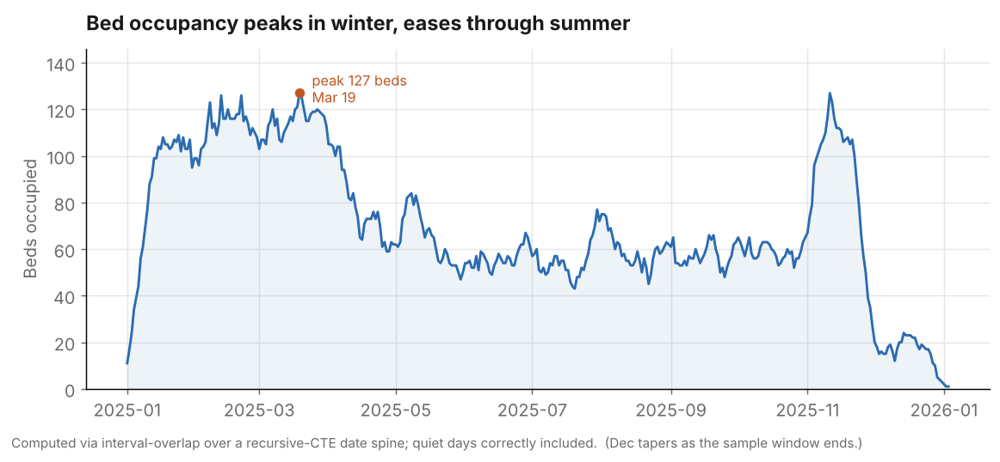
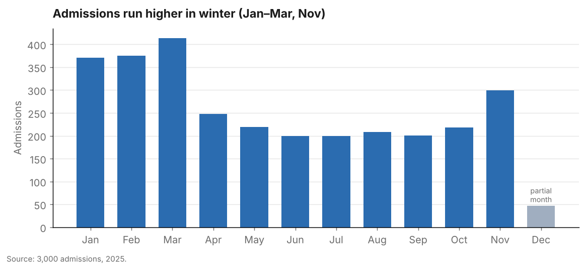

# Findings

Analysis of 3,000 admissions across 2,200 patients and four wards (calendar
year 2025). All figures below are produced by the queries in `sql/03_queries.sql`
run against the data in `sql/02_sample_data.sql`.

> Note: this is realistic **synthetic** data generated by `generate_data.py`
> (seed-fixed, reproducible). It is built to carry real structure — a seasonal
> admissions cycle, differing readmission risk by ward, and ~1% dirty rows — so
> the analysis is meaningful, but the numbers are not from a real hospital.

---

## 1. The overall 30-day readmission rate is 16.2%

Of 3,000 admissions, 486 were followed by a readmission of the same patient
within 30 days of discharge — **16.2%**. That sits in the range real hospitals
see (US all-cause Medicare readmission rates run around 15%), which is the point:
the method and the magnitude are both plausible.

## 2. The ICU is the clear outlier — and it's not close

| Ward | Admissions | Readmissions | 30-day rate |
|------|-----------:|-------------:|------------:|
| **ICU** | 645 | 179 | **27.8%** |
| General Med | 1,324 | 195 | 14.7% |
| Cardiology | 638 | 79 | 12.4% |
| Orthopedics | 393 | 33 | 8.4% |

The ICU readmission rate is roughly **double** the hospital average and **three
times** Orthopedics'. This is the finding a quality team would act on first.
It is also clinically sensible — ICU patients are the sickest, so they bounce
back most — which means the number to chase isn't "get ICU to 8%," it's "how
much of the ICU's 27.8% is avoidable?"

**So what:** target discharge planning and follow-up on ICU and General Med
step-downs, where the volume (1,324 General Med admissions) and the rate (ICU
27.8%) between them account for the large majority of readmissions.

## 3. Readmissions cluster around the two-and-a-half-week mark

Among the 486 readmissions, the **median gap from discharge to return is 18
days**. Very few are immediate. That window matters operationally: a follow-up
touchpoint in the first two weeks after discharge — a call, a clinic visit —
falls before the median readmission, so it has a chance to prevent it.

The conditions most often followed by a readmission are the severe ones:

| Index reason | Readmissions within 30d |
|--------------|------------------------:|
| Septic shock | 46 |
| Respiratory failure | 42 |
| Cellulitis | 35 |
| Post-op monitoring | 34 |
| Pneumonia | 34 |

## 4. Bed demand is strongly seasonal — and nears capacity in winter

Occupancy peaks at **127 beds on March 19** and bottoms out around 55 in
mid-summer, averaging ~70 over the active window. With **150 total beds** across
the four wards, the winter peak runs the hospital at **~85% occupancy** — the
zone where elective scheduling and staffing get tight and turn-away risk rises.

Admissions are visibly higher January–March and in November, consistent with a
winter respiratory/cardiac season. (December in the sample tapers because the
synthetic window stops placing new admissions before year-end — a data artifact,
not a finding.)

**So what:** the capacity pressure is predictable. Winter staffing and
discharge-throughput plans should be in place by December, not improvised in
February.

---

## How these were computed

| Finding | Query | Technique |
|---------|-------|-----------|
| Overall & per-admission readmission flag | Q6 | multi-layer CTE + `LEAD` + date math + `CASE`, guarded with `>= 0 AND <= 30` |
| Ward ranking | Q7 | aggregate the 0/1 flag (`SUM/COUNT`) + `RANK()` |
| Seasonality / running demand | Q8 | `GROUP BY` month; frame-clause running total & moving average |
| Daily bed occupancy | Q9 | interval-overlap non-equi join over a recursive-CTE date spine |

The readmission guard matters here: the raw data contains ~16 rows with a
discharge logged before the next admission (injected dirty data). The `>= 0`
condition excludes them, so they don't inflate the rate.
