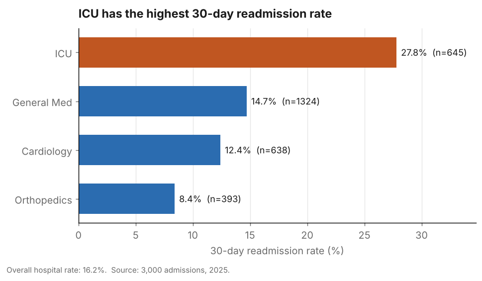

# hospital-readmission-analytics
SQL analytics on hospital admissions — 30-day readmission rates, ward risk ranking, and bed-occupancy analysis using window functions, CTEs, and interval logic. Tested on PostgreSQL.
# Hospital Readmissions Analytics (SQL)

A SQL analytics project on hospital admissions: it measures 30-day readmission
rates, ranks wards by risk, and reconstructs daily bed occupancy — the questions
a hospital analytics team actually reports on. Built end to end, from data
modeling through window functions, CTEs, and interval logic, and tested on a
reproducible 3,000-admission dataset.

All queries run on PostgreSQL. MySQL equivalents for the dialect-specific parts
(date arithmetic) are noted in comments.

## Headline findings

On 3,000 admissions across 2,200 patients (2025):

- **Overall 30-day readmission rate: 16.2%** — in line with real US hospitals.
- **The ICU is the clear outlier at 27.8%** — about double the hospital average
  and triple Orthopedics' (8.4%).
- **Readmissions cluster at a median of 18 days** after discharge — early enough
  that a two-week follow-up touchpoint could intervene.
- **Bed demand is strongly seasonal**, peaking at 127 of 150 beds (~85%) in
  March and easing to ~55 in summer.



Full write-up with all four charts: **[FINDINGS.md](FINDINGS.md)**.

## The business problem

Hospitals are financially penalized when a patient is readmitted within 30 days
of discharge (US Medicare's Hospital Readmissions Reduction Program). High
readmission rates cost money and signal quality-of-care problems. Separately,
bed capacity is a constant operational constraint — a hospital that can't see its
occupancy can't plan staffing or turn-away risk.

Three questions drive the project:

1. Which admissions were followed by a 30-day readmission, and what's the rate?
2. Which wards have the worst readmission rates?
3. How many beds were occupied on each day?

## Schema

One row in `admissions` = **one hospital visit** (not one patient). That is the
key modeling decision: a patient with several visits has several rows, which is
what makes "did they come back within 30 days?" answerable — you have separate
rows to compare.

| Table | One row = | Notes |
|-------|-----------|-------|
| `patients` | one person | Stable facts (name, DOB). `medicare_id` is a plain attribute, not a foreign key — it points at no table. |
| `wards` | one ward | `total_capacity` is stored (stable); "beds available" is **derived**, not stored. |
| `providers` | one doctor | |
| `admissions` | one visit | The central event table. Every foreign key lives here (the "many" side) pointing at the "one" side. |

```
admissions.patient_id   -> patients.patient_id
admissions.ward_number  -> wards.ward_number
admissions.provider_id  -> providers.provider_id
```

## How to run

```bash
# 1. PostgreSQL
createdb hospital
psql -d hospital -f sql/01_schema.sql
psql -d hospital -f sql/02_sample_data.sql
psql -d hospital -f sql/03_queries.sql        # all 9 queries

# 2. (optional) regenerate the sample data
python3 generate_data.py                      # deterministic, seed=42

# 3. (optional) rebuild the charts  (needs pandas + matplotlib)
#    first export the CSVs the script reads, then:
python3 analysis/make_charts.py
```

`sql/sample_output.txt` shows representative real output from a run.

## The queries

| # | Question | SQL concepts |
|---|----------|--------------|
| 1 | Every admission with patient name, newest first | `JOIN`, aliases, `ORDER BY ... DESC` |
| 2 | Admissions per ward, busy wards only, busiest first | `GROUP BY`, `COUNT`, `HAVING` (vs `WHERE`) |
| 3 | Each admission tagged with its ward's total | window fn: `COUNT(*) OVER (PARTITION BY ...)` |
| 4 | Number each patient's admissions chronologically | `ROW_NUMBER() OVER (PARTITION BY ... ORDER BY ...)` |
| 5 | Each admission + that patient's next admission date | `LEAD()` |
| 6 | **Flag 30-day readmissions** | multi-layer CTE + `LEAD` + date math + `CASE` |
| 7 | **Rank wards by readmission rate** | aggregate a 0/1 flag (`SUM/COUNT`) + `RANK()` |
| 8 | Running total + 7-day moving average of admissions | frame clauses (`ROWS BETWEEN ...`) |
| 9 | **Bed occupancy per day** | interval-overlap non-equi join + recursive-CTE date spine |

### Details worth highlighting

**Readmission flag (Q6).** The gap is measured from **discharge** of the first
visit to **admission** of the next (the clock starts when the patient *leaves*).
The flag condition is `days >= 0 AND days <= 30` — the `<= 30` is the window, the
`>= 0` rejects impossible negative gaps from dirty data. The sample data contains
~16 such dirty rows on purpose; the guard excludes them (visible in
`sample_output.txt`, e.g. a −4-day gap flagged 0).

**Rate of a flag (Q7).** A ward's rate is `SUM(is_readmission_30d) / COUNT(*)`.
`SUM` of a 0/1 column counts the 1s (readmissions); `COUNT` counts all rows.
Multiply by `100.0` to force decimal division. This "aggregate a flag" pattern
generalizes to conversion, churn, and pass rates.

**Bed occupancy (Q9).** An admission is an interval
`[admission_date, discharge_date]`; a day is occupied when
`day >= admission_date AND day <= discharge_date` — a non-equi join. The day list
is a **date spine** from a recursive CTE, so *every* calendar day appears,
including quiet days with no new arrivals. `LEFT JOIN` + `COUNT(column)` keeps
those days and reports `0` (a plain `JOIN` would drop them; `COUNT(*)` would
wrongly report `1`).

## Files

```
sql/01_schema.sql        CREATE TABLE statements
sql/02_sample_data.sql   generated sample data (3,000 admissions)
sql/03_queries.sql       all 9 analytics queries, commented, with MySQL notes
sql/sample_output.txt    representative real output
generate_data.py         reproducible data generator (seed=42)
analysis/make_charts.py  builds the charts from exported CSVs
charts/                  the three figures used in FINDINGS.md
FINDINGS.md              the insights, with charts and "so what"
NOTES.md                 full learning walkthrough (every query + the reasoning)
```

## A note on the data

The data is realistic **synthetic** data (`generate_data.py`), built to carry
real structure — a winter admissions cycle, differing readmission risk by ward,
and ~1% dirty rows — so the analysis is meaningful. It is not from a real
hospital, and the December taper in the charts is a sampling-window artifact, not
a finding. Queries are tested on PostgreSQL; the MySQL notes are provided but not
separately tested.
